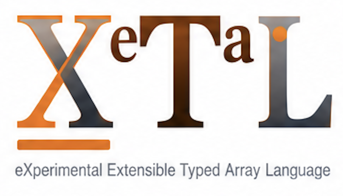

<h1>
  
  
</h1>

Exploring the geometry of machine learning, in
[X_eTaL](https://github.com/softwarewrighter/X_eTaL), the eXperimental
Extensible Typed Array Language: small experiments that change the
shape of the space a model works in and measure what that does, with
every number computed by a short array program you can read.

## Summary

A neural network is usually described with vectors, matrices and
gradients. Each of those is also a piece of geometry: the vectors
live in a space that has a shape, a gradient points "downhill" only
once you have said how distance is measured, and a matrix a network
learns may be held to a set of permitted matrices. These are choices,
and they can be changed one at a time.

This repository asks one question:

> How does the geometry of a representation, a parameter space or a
> computational transformation influence how a machine-learning model
> learns and performs inference?

It is a laboratory, not a gallery and not a geometry library. Every
demo holds to one rule: it compares at least two geometric choices on
the same small machine-learning problem (the same data, split, seeds
and budget), explains why the choice could matter, and measures the
difference. A result that says "this geometry cost more and helped
nothing" is kept and shown.

Five things are kept apart, because each can be changed without the
others:

| Idea | The question it answers |
| ---- | ----------------------- |
| manifold | what space do the data or the representations occupy? |
| vector field | which way does a point move from each place? |
| metric | how are distance, angle and steepness measured? |
| topology | how is the space connected; what holes and loops has it? |
| dynamics | how does a representation move through training or inference? |

What a page promises:

- **One arc.** A question in plain words; the intuition with a
  picture; the mathematics with every symbol explained; an experiment
  you change; an actual small model trained or run; the comparison;
  what it shows, what it does not, and which papers go further.
- **Every number is real.** The points, paths, distances and loss
  figures on a page come from the X_eTaL program it shows; the
  browser's own code draws them and never recomputes them.
- **Words used carefully.** A data manifold, a parameter space and a
  constraint set are different things. The set mHC holds its mixing
  matrices to, the Birkhoff polytope, is a polytope with corners, not
  a smooth manifold, and the pages say so.
- **Nothing oversold.** Figures are marked measured or analytical,
  experiments are small and deterministic, and no geometry is called
  better without the measurement and its limits.

## The X_eTaL repositories

| Repo | What it is |
| ---- | ---------- |
| [X_eTaL](https://github.com/softwarewrighter/X_eTaL) | the language, interpreter, REPL, editor, notebook and browser playground |
| [X_eTaL-demos](https://github.com/softwarewrighter/X_eTaL-demos) | visual array and scientific computing demos |
| [X_eTaL-ML](https://github.com/softwarewrighter/X_eTaL-ML) | machine-learning demos and libraries |
| [X_eTaL-fine-tuning](https://github.com/softwarewrighter/X_eTaL-fine-tuning) | lessons and experiments in fine-tuning, adapters and weight editing |
| **X_eTaL-manifolds** (this repo) | experiments in the geometry of machine learning |
| [X_eTaL-games](https://github.com/softwarewrighter/X_eTaL-games) | interactive games and puzzles |
| [X_eTaL-libraries](https://github.com/softwarewrighter/X_eTaL-libraries) | reusable function and macro libraries |
| [X_eTaL-extensions](https://github.com/softwarewrighter/X_eTaL-extensions) | native Rust extensions and the extension ABI |
| [X_eTaL-gpu](https://github.com/softwarewrighter/X_eTaL-gpu) | X_eTaL programs on GPUs, old ones included (OpenCL) |
| [X_eTaL-fpga](https://github.com/hardwarewrighter/X_eTaL-fpga) | X_eTaL programs as hardware (FPGA circuits) |

## The road

Three hypotheses, each tested with a result that can come out against
it ([`docs/plan.md`](docs/plan.md)):

| # | Hypothesis | The test |
| - | ---------- | -------- |
| H1 | Geometry matching: a space whose geometry matches the structure of the task can improve learning efficiency or generalization | flat, spherical and hyperbolic representations on flat, directional and hierarchical data |
| H2 | Geometric constraints: holding a network's transformations to a constraint set can improve stability and the propagation of information | plain residual, free, doubly stochastic and orthogonal mixing of residual streams at growing depth |
| H3 | Adaptive geometry: learning the geometry together with the model can beat a fixed geometry on mixed tasks | fixed, trainable and mixed curvature on the same data |

The first release is a research foundation and four explorers:

| Explorer | The ML problem | What is compared | The question |
| -------- | -------------- | ---------------- | ------------ |
| Representation | classification and clustering | flat, spherical and hyperbolic space | does it matter what shape of space a model keeps its points in? |
| Optimization | training a small model | Euclidean and metric-aware gradient steps | is "downhill" one direction? |
| mHC | several residual streams mixed at every layer | free, doubly stochastic and orthogonal mixing | what may the mixing be allowed to do? |
| Dynamics | a state that moves step by step | gradient flow and general vector fields; a flow in flat space and one held to a sphere | what decides where a state goes, and must it head downhill? |

Later, each planned when it is reached: learned curvature, the
geometry of attention and generative flows; a laboratory of
constraint sets beyond mHC; topology, dimension and evolving
low-rank subspaces.

## Demos

| Demo | Track | What it shows | Where |
| ---- | ----- | ------------- | ----- |
| [manifold-tour](demos/manifold-tour/) | start | what a manifold is, on five of them: the circle, the sphere, the torus, the Swiss roll and the Poincare disk, each drawn by X_eTaL from its own map and turning in the browser, with its flat view and one measurement each of near and far (the straight line through the space against the distance along it: near pairs agree, far pairs do not); and what each is for in the experiments to come | [live](https://softwarewrighter.github.io/X_eTaL-manifolds/manifold-tour/), `just run manifold-tour` |
| [sphere-hello](demos/sphere-hello/) | start | six points on the unit sphere: the straight line through it and the great circle along it order every point's neighbors the same way (checked on the numbers); the plain average of the points is inside the sphere, and the mean along it is a different direction | `just run sphere-hello` |
| [baseline-knn](demos/baseline-knn/) | start | k nearest neighbors under the straight-line distance on the kit's three data sets (flat clusters, directions, a tree), the same seeded split, each run's accuracy and cost recorded: the row every comparison of H1 is set against (`docs/experiments.md`); and how badly a plain layout of the tree keeps its distances | `just run baseline-knn` |

The live site is <https://softwarewrighter.github.io/X_eTaL-manifolds/>:
the catalog, every page, and the cross-reference of every program and
library. Start with manifold-tour.

## Libraries

A demo's program is a short composition of library functions, and
each function lives where it belongs:

| What | Where | Examples |
| ---- | ----- | -------- |
| particular to manifolds and the geometry of ML | here, in `libs/` | [Manifold](libs/Manifold/) (`mf:`): the unit sphere (distance along it, projection onto it, tangent vectors, a step that stays on it and the arrow that undoes it, a mean on it), the Poincare ball's distance and geodesic (the rest to come), the pictures of the circle, the sphere, the torus and the Swiss roll from their maps, and the distortion of an embedding's distances. [Kit](libs/Kit/) (`kt:`): the experiment kit's data sets, each with a known structure (flat clusters, directions, a tree with its distances) from its own seed. Mixing (`hc:`), to come: residual streams mixed under a constraint |
| general | [X_eTaL-libraries](https://github.com/softwarewrighter/X_eTaL-libraries), asked for | Sinkhorn's iteration, integrators, field and contour pictures; Matrix, Plot, Graphs, Random, Statistics, Trig and Check are used as they are |
| machine learning, not about manifolds | [X_eTaL-ML](https://github.com/softwarewrighter/X_eTaL-ML), asked for | a learning task and its record, a preconditioned optimizer step; NN, Net, Optim, Learn, Embed and Flow are used as they are |

Code a sibling already has is shared, not copied. The pages' teaching
shell (frames, glossary, stepper, heat maps) was written for
X_eTaL-fine-tuning; the refactoring that lets both repositories use
one copy is asked for in
[`docs/xetal-ML-asks.md`](docs/xetal-ML-asks.md) and
[`docs/xetal-fine-tuning-asks.md`](docs/xetal-fine-tuning-asks.md).
Until it lands the pages are built on X_eTaL-ML's page shell alone,
by path from the pinned clone, with this repository's own
[`shared/site`](shared/site/) (its name, its footer with the pins,
its plain framed sections). Rust appears only as the pages'
presentation: every algorithm and every number shown is X_eTaL's.

## Status

| | |
| - | - |
| Now | the experiment kit (step experiment-kit of the first saga, `geometry-lab`, fourteen steps): the Kit library's three seeded data sets, the run's record, `baseline-knn` and the first row of the H1 table; the first live page, [manifold-tour](https://softwarewrighter.github.io/X_eTaL-manifolds/manifold-tour/); the research foundation (`docs/glossary.md`, `docs/papers.md`, `docs/research-questions.md`); the machinery and `sphere-hello` |
| Next | step shell-adoption moves the X_eTaL-ML pin and takes the shared teaching shell and turning view (both landed there); sphere-hello and baseline-knn go live on the shell; then the explorers |
| Asks | the shared teaching shell (GM1, GF1) and the turning view (GM3) have landed in X_eTaL-ML (501ab15, 2026-11-07) and are taken when the pin moves; the function asks are filed ([`docs/xetal-libraries-asks.md`](docs/xetal-libraries-asks.md) GL1 to GL7, [`docs/xetal-ML-asks.md`](docs/xetal-ML-asks.md) GM4 to GM6), none a blocker |

## Build

You need Rust (stable), git, [just](https://github.com/casey/just),
[uv](https://docs.astral.sh/uv/) and
[reg-rs](https://github.com/softwarewrighter/reg-rs); for the pages,
[trunk](https://trunkrs.dev/) and the `wasm32-unknown-unknown` target;
for the browser checks and screenshots, Chrome and ImageMagick.

```bash
just xetal               # clone the pinned X_eTaL-ML and X_eTaL-libraries into work/ and build X_eTaL (once, a few minutes)
just xetal-version       # the pins and the binary's own report
just demos               # the demos, in catalog order
just run sphere-hello    # a demo's program
just show sphere-hello   # the same as a notebook: each statement, then its output
just libs                # the libraries of this repository
just demo Manifold       # a library's demos
just test                # every demo and library baseline
just gate                # the pre-commit gate; just gate --full for everything
just pages               # build the live site into pages/
just serve-pages         # serve it at http://127.0.0.1:3285/X_eTaL-manifolds/
just publish             # pages/ as the gh-pages branch (needs a clean work tree)
```

The repository pins the X_eTaL-ML commit it works with
(`XETAL_ML_COMMIT`, which pins its own X_eTaL) and its own
X_eTaL-libraries commit (`XETAL_LIBRARIES_COMMIT`); `just xetal`
fetches and builds exactly those, into the gitignored `work/`, and
nothing else is installed. `just ml-pin` and `just libs-pin` move a
pin, one at a time. The library search path (`just path`) is this
repository's `libs/*/src`, then X_eTaL-ML's, then X_eTaL-libraries'.

### Layout

- `docs/` -- the plan, the research it came from, and the asks.
- `libs/<Name>/` -- a library of this repository: `src/`, `tests/`
  (reg-rs baselines), `docs/README.md` (the reference), `demos/`.
- `demos/<slug>/` -- one demo per directory: `demo.toml` (what it
  compares, on which problem, for which hypothesis), its `.xtl`
  programs, a README in the page arc, its data and presets, reg-rs
  baselines in `reg/`, and its web page in `web/` when it has one.
- `demos/_template/`, `templates/Library/` -- what `just new-demo`
  and `just new-lib` copy.
- `scripts/` -- the logic behind the `just` recipes, adapted from
  X_eTaL-fine-tuning's (each says where it came from).
- `images/` -- the logo, the favicon and the title.
- `work/`, `pages/`, `target/`, `.venv/` -- gitignored: the clones,
  the built site, the Rust builds, the scripts' Python.

## Documentation

- [`docs/plan.md`](docs/plan.md) -- principles, decisions, the
  hypotheses, the demos and the roadmap
- [`docs/research.txt`](docs/research.txt) -- the survey and the
  design discussion this repository came from (archival; its account
  of papers is checked against the papers before anything is built on
  it)
- [`docs/glossary.md`](docs/glossary.md) -- one name for one thing:
  every term the pages use, in plain words, with what it is not
- [`docs/papers.md`](docs/papers.md) -- the paper catalog: every paper
  the research names, found and read at its source, with the claim
  checked, notes, and what is built from it (links only, no paper is
  tracked)
- [`docs/research-questions.md`](docs/research-questions.md) -- the
  five research areas, H1 to H3 with what counts for and against each
  written before any run, and the experiment schema (presets, a run's
  record, comparisons, baselines)
- [`docs/experiments.md`](docs/experiments.md) -- the results tables
  of the hypotheses, one row per run, null results included
- [`docs/xetal-ML-asks.md`](docs/xetal-ML-asks.md),
  [`docs/xetal-libraries-asks.md`](docs/xetal-libraries-asks.md),
  [`docs/xetal-fine-tuning-asks.md`](docs/xetal-fine-tuning-asks.md)
  -- what is asked of the sibling repositories so that code is shared
  and not copied, and the functions each is asked for
- [`CHANGES.md`](CHANGES.md) -- every commit, newest first
- each library's reference: [`libs/Manifold/docs/README.md`](libs/Manifold/docs/README.md), [`libs/Kit/docs/README.md`](libs/Kit/docs/README.md)

## Development

Development is tracked with agentrail sagas, as in X_eTaL:
`agentrail status` shows the current step, `agentrail next` its
instructions. Every step ends with the gate passing, docs updated, a
commit to `main` and a push. The rules agents follow are in
[`CLAUDE.md`](CLAUDE.md) (`AGENTS.md` is the same file).

## Related Projects

- [X_eTaL-ML](https://github.com/softwarewrighter/X_eTaL-ML) -- the
  ML libraries and demos these experiments are built on.
- [X_eTaL-fine-tuning](https://github.com/softwarewrighter/X_eTaL-fine-tuning)
  -- where geometric ideas are applied to adapting a model (low-rank
  adapters, shared subspaces).
- [sw-mlpl](https://github.com/sw-ml-study/sw-mlpl) -- Software
  Wrighter's Machine Learning Programming Language, a Rust array
  language inspired by APL, APL2, J, and BQN.

## Links

- Blog: [Software Wrighter Lab](https://software-wrighter-lab.github.io/)
- Discord: [Join the community](https://discord.com/invite/Ctzk5uHggZ)
- YouTube: [Software Wrighter](https://www.youtube.com/@SoftwareWrighter)

## Copyright

Copyright (c) 2026 Michael A Wright

## License

MIT. See [`LICENSE`](LICENSE) and [`COPYRIGHT`](COPYRIGHT).
