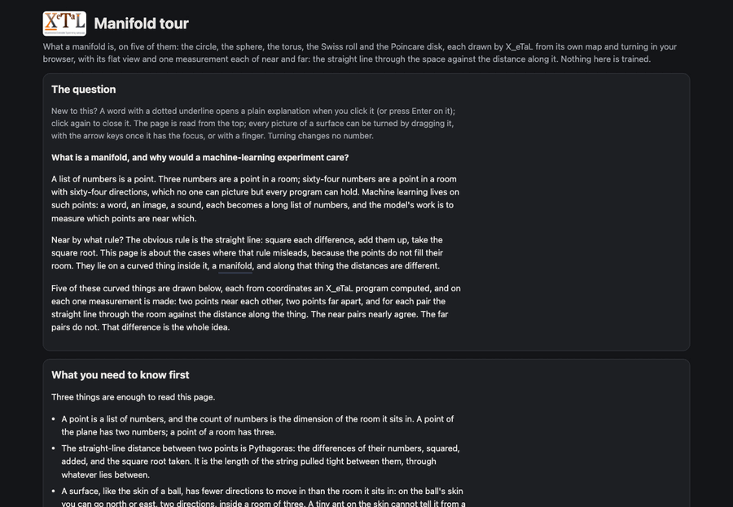

# Manifold tour

The first live page of this repository, and the page a newcomer meets
first: what a manifold is, on five of them (the circle, the sphere,
the torus, the Swiss roll and the Poincare disk), each drawn by X_eTaL
from its own map, turning in the browser, with its flat view and one
measurement each of near and far: the straight line through the space
against the distance along it. Live at
<https://softwarewrighter.github.io/X_eTaL-manifolds/manifold-tour/>.



## The question

What is a manifold, and why would a machine-learning experiment care?

## Background

A point is a list of numbers, and the count of numbers is the
dimension of the room it sits in. The straight-line distance between
two points is Pythagoras on their differences. A surface like the skin
of a ball has fewer directions to move in than the room it sits in,
and an ant on it cannot tell it from a floor. Nothing here is trained
or random: the program computes points, lines and distances, and the
page draws and quotes them.

## The idea

A manifold is a space that is locally flat: a small enough piece of it
is, as near as you like, an ordinary flat space. The number of
directions along it is its intrinsic dimension; the number of
coordinates of the room it is drawn in, its ambient dimension. Locally
flat can be measured: between two points close together, the straight
line through the room and the shortest path along the manifold (a
geodesic) are nearly the same length; between two points far apart
they are not. Machine learning cares because data often lies near a
curved thing of low intrinsic dimension inside a room of high ambient
dimension (the manifold assumption, an assumption), a representation
can be put on a chosen manifold, an optimizer's step has a metric, and
a set of allowed parameters is a curved set of its own (some smooth
manifolds, some polytopes, which are not).

## What this is, and is not

An introduction and a proof of a chain: it introduces what a manifold
is on five of them, and it proves that a page here can run an X_eTaL
program in the browser, read every coordinate back and draw it
turning. It trains nothing and compares no models; the only
comparison is of two distances, for a near pair and a far pair of
points on each space.

## The intuition

An ant on a ball: under its feet the ball is a floor, and two ants a
step apart measure the same gap through the air or along the ball;
two ants on opposite sides cannot stretch a string along the ball at
all. On the Swiss roll the floor is the rolled sheet: a point on the
next layer out is a step away through the air and a turn away on the
floor, and a method that cannot tell the two apart calls them
neighbors.

## The mathematics

The straight line between p and q: the differences of their
coordinates squared, added, rooted (Pythagoras). The great circle on
the unit sphere: the angle between p and q, computed as
2 atan2(|p - q|, |p + q|), which keeps its digits for near points
where acos of the dot product does not. The Swiss roll's point at
(t, h) is (t cos t, h, t sin t); the length along its spiral from the
middle is (t sqrt(1 + t^2) + asinh t) / 2 and the sheet is flat, so
the distance along it is Pythagoras on (that length, h). The Poincare
disk's distance is 2 atanh of the length of q seen from p by Mobius
addition. Each space's map is the pair of numbers its points are made
from: its intrinsic dimension is the count of those, its ambient
dimension the count of coordinates they are turned into.

## What is compared

An introduction (`intro = true` in `demo.toml`): it compares no
geometries on a learning problem. On each of the five spaces it
compares the straight line through the surrounding space with the
distance along the space, for a near pair of points and a far pair:

| Space | Near pair | Far pair |
| ----- | --------- | -------- |
| circle | 0 and 0.1 radians: chord 0.1000, arc 0.1000 (ratio 1.0004) | 0 and 2.5 radians: chord 1.8980, arc 2.5000 (ratio 1.3172) |
| sphere | p (20 E, 30 N) and q (26 E, 33 N): chord 0.1034, great circle 0.1035 | p and r (110 E, 35 S): chord 0.5176, great circle 0.8727 (ratio 1.686) |
| torus | the outer ring and the inner ring, the same line of the map, measured along the wire: 25.11 against 12.56 (ratio 2.000) | |
| Swiss roll | a and b, 0.3 farther round: through the air 1.6263, along the sheet 1.6328 | a and c, one turn farther round: through the air 6.2832, along the sheet 52.8061 (ratio 8.4) |
| Poincare disk | s' and t' near the middle, 20 degrees apart: on paper 0.0347, by the disk 0.0701 (ratio 2.02) | s and t near the rim, 20 degrees apart: on paper 0.3299, by the disk 3.8667 (ratio 11.7) |

The near pairs nearly agree (locally flat); the far pairs do not. The
torus's measurement is of its map's honesty: the same row of the map
is twice as long outside the ring as inside it. Every number is in
`reg/cli-manifold-tour.out`.

## The run

Nothing is trained and no model is run: the only computation is the
program, which makes the five spaces from their maps and measures the
pairs. The experiments that train something begin with baseline-knn
and the explorers after it.

## The program

`manifold-tour.xtl`, on the Manifold library (`mf:`), Trig and Check:

- the core (between `# -- the tour` and `# -- end of the core`): each
  space's wire lines from its map (`mf:c_irclePoints`,
  `mf:s_pherePoints`, `radii mf:t_orusPoints UV`, `mf:r_ollPoints`,
  the disk's rim), the three points of each, the arcs
  (`(p, q) mf:s_phereArc n`, `(p, q) mf:b_allGeodesic n`), the
  distances (`mf:s_phereDistance`, `mf:r_ollDistance`,
  `mf:b_allDistance`, and the straight line), the disk's ruler, the
  chord from p to q worked step by step, and the dimensions read off
  the arrays' shapes;
- after it, the command-line sections: each space's shapes, points
  and distances printed, with Check's tests of the claims (every wire
  point on its space, the near ratio within a part in a thousand, the
  far ratio large, the geodesics inside the disk, a diameter
  straight).

The page (`web/`) runs the same core followed by one `r_avel` line per
array, parses them (`src/micro.rs`, tested natively in `tests/` against
the command-line baseline) and draws them (`src/app.rs`); the turning
is `src/turn.rs`, an orthographic projection of X_eTaL's coordinates
by yaw and pitch (see Workarounds). The page shows all the code it
runs.

## How it works

Each space has a map (its own coordinates) and a function from the map
into the room: the circle's angle to (cos a, sin a); the sphere's
longitude and latitude; the torus's two angles with its two radii; the
roll's (t, h) to (t cos t, h, t sin t), with the length along the
spiral (t sqrt(1 + t^2) + asinh t) / 2 as the unrolled coordinate.
Distances along: the sphere's is 2 atan2(|p - q|, |p + q|) (accurate
near 0, where acos of the dot product is not); the roll's is Pythagoras
in the unrolled coordinates, because the sheet is flat; the disk's is
2 atanh of the length of q seen from p by Mobius addition, and its
geodesic is p plus the ball's fraction of the arrow to q. The wire
lines are analytical (a formula drawn); the distances are measured.

## Results

The ratios, along against through, from the run: circle 1.0004 (near)
and 1.3172 (far); sphere 1.0004 and 1.686; Swiss roll 1.004 and 8.40;
Poincare disk 2.02 near the middle and 11.7 near the rim; the torus's
outer ring is 2.000 times its inner ring's length. The near pairs are
within a part in a thousand (half a percent on the roll) of 1, as the
page's hypothesis said; the far pairs are not. The disk's near pair is
2.02 because the disk's ruler is twice the plain one even at the
middle. Nothing here can count against locally flat: the spaces are
formulas made so; the measurement shows the size of the effect.

## Beyond this page

What this rests on, read at source (`docs/papers.md`): Isomap
(Tenenbaum, de Silva and Langford, 2000) for the Swiss roll and the
two distances; Fefferman, Mitter and Narayanan (2016) for the manifold
assumption as a testable assumption; Ungar's gyrovector forms as
Ganea, Becigneul and Hofmann (2018) write them for the disk. Open for
this repository: whether a geometry that matches the data helps a
model learn (H1), which representation-explorer tests with
baseline-knn as its first row. Not established here: that any real
data set is a manifold; the five spaces are formulas.

## Run it

```bash
just run manifold-tour       # the program, with its checks
just show manifold-tour      # as a notebook
just test-demo manifold-tour # the CLI baseline, the web crate's tests, the browser check
just serve manifold-tour     # the page on port 3285
```

## Summary

Five manifolds, each turning from X_eTaL's coordinates with a flat
view and the numbers beside it; on each, a near pair of points whose
two distances agree and a far pair whose distances do not, which is
what locally flat means and why the straight line through the room is
the wrong distance for far pairs on a manifold. The page trains
nothing and claims no geometry better; the pages after it compare
geometries on learning problems. Next: the research foundation (the
glossary, whose first rows are this page's words; the paper catalog;
the hypotheses), then the experiment kit and the explorers.

## Next

sphere-hello, live: six points on the sphere, the two distances for a
pair the reader picks, the neighbors under each, the plain mean and
the mean on the sphere. baseline-knn, live: the three data sets and
the H1 table's first row. Then the explorers.

## Workarounds

- `u:p_airs` (two vectors side by side as rows), `u:e_ach` and
  `u:t_imes` (repeating), `u:l_ength` (a polyline's length) and
  `u:s_traight` (the straight-line distance) are written out in the
  program: general array words, for X_eTaL-libraries (to be asked for
  in `docs/xetal-libraries-asks.md` by step research-foundation, with
  sphere-hello's `u:c_hords`).
- The page's turning views are X_eTaL-ML's shared `microscope::turning`
  (ask GM3, landed); its frames, glossary, asides and code links are
  the shared teaching shell's (`shared/lesson`, ask GM1, landed). The
  page's own parts are `shared/site`'s: the six added frames, the
  marks, the comparison table (ask GM8) and the aside for this
  repository's own library functions (ask GM7).
